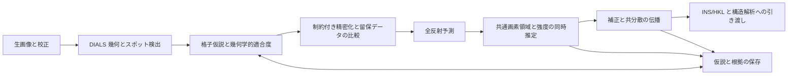

> Version notice: this is the inherited R2 guide. For the 0.7.0 reconstruction, read README.md and AGENT_GUIDE.zh-CN.md. Historical test claims below are not current validation.

# Ariadne

**単結晶回折データの処理、複数格子解析、および反射強度の同時推定を行う エージェントネイティブ計算フレームワーク。**

[English](README.md) · [简体中文](README.zh-CN.md) · [日本語](README.ja.md) · [商用ライセンス](LICENSE)

Ariadne は、回転法による回折画像を、科学的根拠を保持する結晶学ワークフローに接続する。装置幾何、スポット検出、格子仮説、同時精密化、全反射予測、重なり反射の積分、補正、構造解析への引き渡しを対象とする。低分子、配位化合物、材料結晶を想定し、大きな単位格子、複数の方位ドメイン、または同時に照射される独立結晶を扱う。

数値計算の基盤は DIALS、dxtbx、cctbx、NumPy、SciPy である。Ariadne は明確に定義された DIALS Python ソース拡張と独立した科学計算アダプターを提供する。決定論的なツールが幾何と画素データを評価し、エージェントが計算方針、資源配分、根拠の確認、および代替仮説の保持を担う。

## 1. 科学的対象範囲と構成

主な入力は、単一波長の X 線回転画像と、解釈可能な検出器、入射ビーム、ゴニオメーター、スキャンのメタデータである。Bruker または Rigaku のデータを処理できるかは、対応する dxtbx リーダーが実際の実験幾何を復元できるかによって決まる。拡張子だけでは、形式の互換性や校正の妥当性は確認できない。

実験観測と理論反射は別のデータオブジェクトとして扱う。一つの画素領域には複数の反射が寄与し、一つの反射が複数フレームにまたがる場合もある。Ariadne はこれらの関係を保持し、各観測スポットに単一の格子ラベルを強制しない。



同一相の方位ドメイン、結晶学的双晶、独立結晶、異なる結晶相は、それぞれ異なる物理的解釈を必要とする。類似した単位格子や複数の方位行列だけでは、双晶則や構造因子強度の共有を正当化できない。

## 2. DIALS ソースへの組み込み

ソースパッチは [`patches/dials-3.30.1-ariadne.patch`](patches/dials-3.30.1-ariadne.patch) にあり、互換性の対象は DIALS **3.30.1** である。インストーラーは対応する上流ソースを取得してパッチを適用し、明示的な `PYTHONPATH` オーバーレイから、互換性のあるインストール済みコンパイル拡張を利用する。

| DIALS の接続箇所 | Ariadne における機能 |
|---|---|
| `algorithms/indexing/lattice_search/__init__.py` | `ariadne` 候補スコアラー、PHIL パラメーター、および構造化された候補評価の出力を登録する。 |
| `algorithms/indexing/model_evaluation.py` | スキャンブロック単位で精密化データを分割し、共通の装置幾何を固定する。精密化した結晶を留保観測で評価し、評価根拠を候補結果に付加する。 |
| `extensions/ariadne_spotfinder_threshold_ext.py` | DIALS threshold インターフェースを実装し、校正に基づく複数スケールの画素候補抽出を `ariadne.spots` に委譲する。 |

指数付けの評価と格子選択は Python ソースへの変更であり、スポット検出モジュールは登録拡張である。局所プロファイル学習、非排他的な対応付け、画素の同時積分は独立したアダプターであり、DIALS C++ カーネルの置換ではない。上流の既定アルゴリズムも利用でき、Ariadne の threshold と scorer は明示的に選択する。

### 2.1 校正に基づく複数スケールのスポット候補抽出

ADU 画素値 $Y_j$、校正済みオフセット $b_0$、ゲイン $g$（ADU/光子）に対し、検出に用いる座標を

$$
X_j=\frac{Y_j-b_0}{g},\qquad v_r=\frac{\sigma_r^2}{g^2}
$$

と定義する。

マスクはすべての局所和に適用する。候補の信号支持領域を除いた環状近傍から有効画素の背景を推定し、**背景推定**を正方向に汚染する画素を反復的に除外する。実測画像値は保持する。有効な背景支持が不足する場合は候補を生成しない。

複数サイズの矩形カーネルを評価する。カーネル内の観測和を $n$、期待背景和を $\mu$ とすると、ポアソン分岐の片側逸脱度（deviance）スコアは

$$
T(n,\mu)=
\begin{cases}
\sqrt{2\left[n\log(n/\mu)-n+\mu\right]},& n>\mu,\\
0,& n\leq\mu
\end{cases}
$$

である。

期待計数の下限 0.5 は、背景サンプルが空の場合の数値正則化であり、実測計数や分散を意味しない。積分型検出器の分岐では、ゲイン、読み出し雑音、背景推定の不確かさを含む準ガウス型の超過スコアを使用する。厳密な ポアソン–ガウス畳み込み尤度ではない。

いずれかのスケールが閾値を超え、画素が局所支持条件を満たす場合に候補信号として提案する。その後 DIALS が連結スポットを構築し、結晶学的な指数付けを行う。したがって、このスコアが示すのは候補信号であり、独立に確認された Bragg 反射ではない。適応的な背景推定とスケール選択を含むため、校正済みの偽陽性確率としては解釈しない。

矩形和は分離可能な移動フィルターで計算する。画素数 $N$、スケール数 $S$ に対し、計算量はおおむね $O(SN)$ であり、各画素で近傍全体を走査するループを避ける。これは計算構造の説明であり、実測の高速化率を示すものではない。

実装：[`python/src/ariadne/spots.py`](python/src/ariadne/spots.py)。

### 2.2 スキャンブロック単位の留保評価

候補評価器は、元の `imageset_id` と

$$
\operatorname{block}(i)=\left\lfloor\frac{z_i}{L}\right\rfloor
$$

により観測をグループ化する。$z_i$ はフレーム座標、$L$ はブロック幅である。固定乱数 seed により完全なブロックを選択し、短い結晶精密化から除外する。候補ごとに変化する割り当て済み反射 ID を分割の基準には用いない。

候補精密化ではビーム、検出器、ゴニオメーターを固定し、共通の装置座標系で逆空間座標を比較する。その後の格子スコアには初期行列だけでなく、精密化した結晶を用いる。

これは**精密化に条件付けた留保評価**である。候補生成、初期 HKL 割り当て、非原始単位格子の処理には、留保された観測が既に使用されている可能性がある。独立した全処理の交差検証ではなく、ブロック分割自体が隣接ブロックの統計的独立性を保証するわけでもない。

### 2.3 周期格子密度による候補スコア

$2\pi$ 因子を含まない結晶学的逆空間の規約を用いる。候補行列 $A=UB$ に対して

$$
\mathbf q=\mathbf s_1-\mathbf s_0,\qquad
|\mathbf s_0|=|\mathbf s_1|=1/\lambda,\qquad
\mathbf f=A^{-1}\mathbf q
$$

とする。

最も近い格子点への ユークリッド残差だけでは、過密な逆格子が有利になる場合がある。Ariadne は無次元の周期ガウス密度比を評価する：

$$
R_A(\mathbf q)=|\det A|\sum_{\mathbf h\in\mathbb Z^3}
\frac{\exp\left[-\|\mathbf q-A\mathbf h\|^2/(2\sigma_q^2)\right]}
{(2\pi\sigma_q^2)^{3/2}}.
$$

$|\det A|$ は $A$ が張る逆格子単位胞の体積である。この体積を乗じることで、候補の基本単位胞内の一様密度に対する比として周期密度を表現する。逆格子点を密にするだけで観測を説明する傾向を抑えるための項であり、完全な超格子または相の判定を置き換えるものではない。

候補の順位付けに用いる統計量は

$$
\mathcal S(A)=\frac{1}{N_{\mathrm{val}}}
\sum_{i\in\mathrm{val}}
\log\left[(1-\eta)+\eta R_A(\mathbf q_i)\right]
$$

である。

ガウス幅 $\sigma_q$ と混合重み $\eta$ は、明示的に設定する仮定である。特に $\eta$ は双晶ドメインの体積分率ではない。スコアは候補順位の診断量であり、格子数や空間群について校正されたベイズモデル証拠 ではない。密度モデルは整数格子位置と等方的雑音を用い、系統的消滅や反射強度の尤度を含まない。

候補には、留保観測の支持数と、中心化した HKL の三次元の階数条件も要求する。訓練支持の不足、無効な分割、周期和の予算不足がある候補は、受理可能なスコアを得ない。

### 2.4 適応的周期近傍とメモリ制御

無限和は $\operatorname{round}(A^{-1}\mathbf q)$ の周囲で近似する。分数座標の雑音幅と検索半径は

$$
\sigma_{f,j}=\sigma_q\|\operatorname{row}_j(A^{-1})\|_2,
\qquad
r_j=\max\left(1,\left\lceil\tfrac12+t\sigma_{f,j}\right\rceil\right)
$$

である。

検索半径は単位格子の計量と雑音の仮定に応じて変わり、すべての単位格子を固定の 27 近傍点に制限しない。設定された半径予算が検索範囲を制限する。バッチ評価では作業メモリの見積もりから chunk size を選び、`logsumexp` により ガウス和の数値アンダーフロー を避ける。有限近傍は数値近似であり、保証された打ち切り誤差上限ではない。

| パラメーター | 意味 | 既定値 |
|---|---|---|
| `holdout_block_frames` | 留保ブロックの幅 | 20 フレーム |
| `holdout_fraction` | 留保するブロックの概略比率 | 0.2 |
| `q_sigma` | 仮定する逆空間座標の雑音幅 | 0.001 Å⁻¹ |
| `tail_sigma` | 分数雑音幅で表した近傍範囲 | 6 |
| `max_periodic_radius` | 各軸の最大整数検索半径 | 6 |
| `score_chunk` | 要求する観測バッチサイズ | 512 |
| `lattice_fraction` | 作業モデルの混合重み $\eta$ | 0.6 |

これらは調整可能なアルゴリズム設定であり、すべての実験で成立する校正常数ではない。候補記録には単位格子、$A$、支持数、残差、近傍サイズ、評価の仮定を保持する。

実装：[`python/src/ariadne/ranking.py`](python/src/ariadne/ranking.py)。

## 3. 複数格子の適合度と幾何の同時精密化

完全な DIALS 反射予測は、Ewald 球と装置幾何に基づく検出器位置およびスキャン角を与える。逆空間による候補絞り込み後、mm/mm/radian の整合した単位で観測と予測を比較する：

$$
\mathbf r_{ikh}=\mathbf y_i-\boldsymbol\mu_{kh},\qquad
C_{ikh}=\Sigma_i+\Sigma_{kh}^{\mathrm{model}},\qquad
D_{ikh}^2=\mathbf r_{ikh}^{\mathsf T}C_{ikh}^{-1}\mathbf r_{ikh}.
$$

適合度は $r_{ikh}=\exp(-D_{ikh}^2/2)$ とする。一つの観測スポットに複数の予測を保持でき、スコアの総和を 1 に制約しない。モデル共分散と実測重心分散を必要とし、観測共分散には対角近似を用いる。ネイティブの連続したスキャン角を保持することで、角度の周期性だけによって異なる回転の露光を統合しない。

幾何学的適合度、画素強度の寄与、ドメイン分率は異なる量である。位置の適合だけでは、その格子に属する実測強度は決まらない。

同時精密化アダプターは、**一意に説明されるアンカー観測**、連続的な適合重み、および DIALS ネイティブ refiner を使用し、装置幾何を固定する。複数の潜在的寄与を持つ重心は画素解析のために保持し、複数回の独立した幾何測定として複製しない。精密化した代替仮説は、同じ留保観測行と校正条件で比較する。説明率や適合度の改善も、物理的解釈を必要とする診断量である。

実装：[`soft_multi_indexer.py`](skills/ariadne-reduction/scripts/soft_multi_indexer.py)、[`joint_geometry_refine.py`](skills/ariadne-reduction/scripts/joint_geometry_refine.py)、[`compare_hypotheses.py`](skills/ariadne-reduction/scripts/compare_hypotheses.py)。

## 4. 局所経験プロファイル

孤立した参照 shoebox から、背景を差し引いた非負の経験プロファイルを得る。プロファイルを重心で整列し、共通の有限支持上で規格化する。検出器位置とスキャンからなる有限グリッド内で、局所プロファイルを 統合参照へ縮約する：

$$
P_c=\alpha_c\overline P_c+(1-\alpha_c)P_{\mathrm{pool}},
\qquad \alpha_c=\frac{n_c}{n_c+\kappa}.
$$

$n_c$ は局所参照数、$\kappa$ は設定する縮約の強さである。非負の三線形補間により規格化を保持する。参照不足の節点や参照領域外では 統合参照プロファイルを用いる。弱反射ごとに任意の形状を独立に当てはめず、有限の局所変動を許容する。

プロファイルの校正、完全な支持、孤立性の根拠、参照選択の来歴を明示する。プロファイルは条件付きの経験的検出器空間モデルであり、その推定誤差は報告される強度共分散に含まれない。

実装：[`learn_profile_library.py`](skills/ariadne-reduction/scripts/learn_profile_library.py)、[`local_profiles.py`](skills/ariadne-reduction/scripts/local_profiles.py)。

## 5. 重なり反射の同時積分と識別可能性

### 5.1 共通画素の観測

すべての候補格子から、初期スポット表に存在しない弱反射も予測する。信号支持と背景マージン により、同一の生スキャンおよび検出器 panel 上に保守的な連結領域を構成する。各領域は、その寄与反射集合に対して一度だけ抽出する。

積分ボックスの交差はグループ化の基準である。信号プロファイルの重なりと統計的な分離可能性は、設計行列およびプロファイル相関から別途評価する。

### 5.2 符号を制限しない重み付き最小二乗

グループ内のモデルを

$$
\mathbf y=P\mathbf I+B\boldsymbol\beta+\boldsymbol\epsilon,
\qquad W=\operatorname{diag}(v_j^{-1})
$$

とする。

$P$ の各列は完全な支持上で規格化されたプロファイルであり、$B$ は定数または低次の位置/スキャン背景を表す。符号を制限しない WLS は、弱反射の雑音から生じる負の強度推定を保持する。

$W^{1/2}B=QR$ と置き、背景の 付随パラメーター方向を

$$
D=(I-QQ^{\mathsf T})W^{1/2}P,\qquad
\widetilde{\mathbf y}=(I-QQ^{\mathsf T})W^{1/2}\mathbf y
$$

によって除去する。

射影は行列積として適用し、画素数の二乗に相当する密な射影行列は構築しない。列の規格化と SVD により、保持する信号部分空間とその条件付き共分散を求める。

列スケール行列を $S$、$DS^{-1}$ の零空間基底を $V_0$ とすると、

$$
V_0^{\mathsf T}S^{-1}\mathbf c=0
$$

の場合に強度コントラスト $\mathbf c^{\mathsf T}\mathbf I$ が推定可能となる。

個別強度、総強度、未解決グループは異なる出力状態である。$P_1=P_2$ の場合、画素は $I_1+I_2$ を決めるが、それぞれの成分を決めない。任意の擬似逆行列解や非負分割を、測定された成分強度として出力しない。

### 5.3 非負推定器

NNLS 分岐では、顕著なプロファイル支持の外側から低次背景を推定して固定し、

$$
\min_{\mathbf I\geq0}
\left\|W^{1/2}(\mathbf y-\mathbf b-P\mathbf I)\right\|_2^2
$$

を解く。

確認された光子計数に対し、ポアソン分岐は

$$
\mathcal L(\mathbf I)=\sum_j
\left[\lambda_j-N_j\log\lambda_j\right],
\qquad \lambda_j=b_j+\sum_a I_aP_{ja},\quad I_a\geq0
$$

を最小化する。

校正済みゲイン、除去済みオフセット、読み出し分散ゼロ、および有効画素上の非負整数光子計数を要求する。結果と共分散は補正との整合性のため 校正済み ADU 規約に戻す。無視できない読み出し雑音を持つ積分型検出器には適切な重み付き近似を用い、理想的な光子計数 ポアソン分岐は適用しない。

符号を制限しない WLS の条件付き共分散には、与えられたプロファイル、幾何、雑音モデルを条件として 背景の付随パラメーター の不確かさが含まれる。背景を固定した非負分岐では背景推定誤差を伝播しない。ガウス近似・Fisher 情報近似は境界での信頼区間ではなく、非負境界に達した識別可能な強度には品質フラグを付ける。profile-likelihood または bootstrap による境界区間は提供しない。

実装：[`overlap_prepare.py`](skills/ariadne-reduction/scripts/overlap_prepare.py)、[`overlap_integrator.py`](skills/ariadne-reduction/scripts/overlap_integrator.py)、[`constrained_pixels.py`](skills/ariadne-reduction/scripts/constrained_pixels.py)。

## 6. 強度の規約、補正、および出力

推定振幅は完全に規格化されたプロファイルを基準とする。有効観測支持の質量が $p_a$ なら、観測に対応する振幅は $p_aI_a$ である。これはプロファイルモデルに基づく有効支持質量であり、独立に測定した幾何学的 partiality ではない。後段で完全プロファイル振幅をこの質量で再度割ってはならない。

成分補正 $\mathbf z=\mathbf f\odot\mathbf I$ に対し、$F=\operatorname{diag}(\mathbf f)$、$J=\operatorname{diag}(\mathbf I)$ と定義すると、一次の誤差伝播は

$$
C_z=FC_IF+JC_fJ+FC_{If}J+JC_{If}^{\mathsf T}F
$$

となる。

グループ総強度の分散は $\mathbf1^{\mathsf T}C_z\mathbf1$ である。補正因子の不確かさ、および強度と補正因子の交差共分散が関係する場合は、それらを入力する。生の総強度だけが識別可能な場合、現在の補正アダプターは共通補正因子を要求する。成分ごとに異なる因子には、全観測を用いるモデルが必要となる。

補正アダプターは来歴を持つ Lorentz/偏光、スケール、吸収因子を適用する。完全な双晶対応の全体吸収/スケーリングモデルを推定するものではなく、各ドメインを同じ平均強度に規格化して物理的な相対寄与を消去しない。

内部 JSON/JSONL 表現は寄与反射の対応、共分散、来歴、仮説間の関係を保持する。HKLF 5 は、実際に補正された同一相の複合観測を下流へ渡す表現であり、観測から出力行への対応表を付ける。成分間または観測間の共分散全体は記述できない。構造解析用 HKLF 4 と双晶精密化用 HKLF 5 は区別し、無関係な結晶相を一つの双晶構造として出力しない。

## 7. Agent インターフェース

ローカル MCP server は、実行時間を制限した型付き操作、上書きしない仮説記録、および追記専用イベントログを提供する。科学的な受理は、プロセスの正常終了とは別の判断である。

| ツール | 役割 |
|---|---|
| `capabilities` | ソフトウェア設定と対応操作を確認する。 |
| `create_job` | 元入力を保持し、独立した作業データセットを作成する。 |
| `start_operation` | 固定された DIALS ネイティブ操作を非同期で実行する。 |
| `start_analysis` | 登録された Ariadne 科学計算アダプターを実行する。 |
| `inspect_job` | ステージ、仮説、計算操作の状態を取得する。 |
| `read_artifact` | 長さを制限したテキストの根拠とログを取得する。 |
| `propose_hypothesis` | 候補、根拠の参照、親仮説との関係を保持する。 |
| `record_acceptance` | 根拠に基づく科学的判断を記録する。 |
| `make_handoff` | 受理された INS/HKL を `solve-single-crystal` 向けにまとめる。 |

科学計算アダプターは soft assignment、幾何の同時精密化、プロファイル学習、重なり領域構築、強度同時推定、仮説比較、HKLF 5 出力を含む。コマンドは引数リストとして実行し、任意の shell 実行入口は提供しない。エージェントは強度推定に使用する数値配列を直接変更しない。

## 8. インストールと操作

インストーラーは、Git、`curl`、`patch`、互換性のある conda/mamba を備えた macOS/POSIX 環境を対象とする。ソースパッチは DIALS 3.30.1 を必要とし、科学計算環境は Python 3.12 を使用する。提供するインストーラーはネイティブ Windows 展開を対象としない。

```bash
git clone https://github.com/owenxyzhang-seseTJ/Ariadne.git
cd Ariadne
sh scripts/install_local.sh
codex plugin marketplace add "$PWD" --json
codex plugin add ariadne@ariadne-local --json
```

インストーラーの任意引数として base-environment prefix と新規 runtime ディレクトリを指定できる。`ARIADNE_MAMBA` は mamba 実行ファイル、`ARIADNE_SOURCE_ARCHIVE` は対応するローカル上流アーカイブを指定する。生成される `ariadne-env` ランチャーがソースオーバーレイとローカル MCP 依存関係を選択する。インストール自体は科学計算を実行しない。

実際の入力を置いた独立計算ディレクトリで、ソース拡張を明示的に選択する：

```bash
# CALIBRATED_GAIN は検出器校正に由来する値を指定する。
ariadne-env dials.find_spots imported.expt \
  spotfinder.threshold.algorithm=ariadne \
  spotfinder.threshold.ariadne.noise_model=poisson \
  spotfinder.threshold.ariadne.gain_adu_per_photon="$CALIBRATED_GAIN"

ariadne-env dials.index imported.expt strong.refl \
  indexing.basis_vector_combinations.solution_scorer=ariadne \
  indexing.basis_vector_combinations.ariadne.evidence_directory=candidate_evidence
```

エージェントによる処理では `$ariadne-reduction` を呼び出す。[スキル入口](skills/ariadne-reduction/SKILL.md) は入力データの階層別経路と根拠要件を定義する。詳しい契約は、[複数格子の方法論](skills/ariadne-reduction/references/probabilistic-multilattice.md)、[ソース拡張仕様](skills/ariadne-reduction/references/source-extensions.md)、[重なり積分仕様](skills/ariadne-reduction/references/overlap-integration.md) を参照。

## 9. 科学的適用性

提供されるアルゴリズムは、公表されたベンチマーク検証を持たない実験的実装である。数値閾値と不確かさの仮定は、データセットごとに評価する必要がある。定量的な精度または処理速度の優位性は主張しない。

幾何アダプターは静的な回転モデルを前提とする。完全な多成分重心尤度の最適化、正式なベイズ推論による格子数選択、複合観測を考慮した全体吸収/スケーリング、およびプロファイル/幾何推定誤差の伝播は、実装した数値モデルの対象外である。動的な構造解釈には、独立した校正と識別可能な装置–試料モデルが必要となる。

## 10. ライセンスと参考資料

Ariadne の独自に作成したソフトウェアと文書は専有であり、商用利用には [LICENSE](LICENSE) と [LICENSING.md](LICENSING.md) に基づく書面ライセンスが必要である。コミット 407d193 までのリリースは [MIT License](LICENSE-MIT) で利用できる。DIALS 由来のソース部分には上流の BSD 条件を保持し、[`patches/DIALS-LICENSE`](patches/DIALS-LICENSE) に収録する。第三者依存関係はそれぞれのライセンスに従う。公式 DAFi バイナリーや専有の測定・データ処理プログラムは、本リポジトリーに含まれない。

- Winter ほか：**DIALS: implementation and evaluation of a new integration package.** *Acta Crystallographica D* 74, 85–97。[DOI: 10.1107/S2059798317017235](https://doi.org/10.1107/S2059798317017235)。
- Sevvana ほか：**Non-merohedral twinning: from minerals to proteins.** *Acta Crystallographica D*。[DOI: 10.1107/S2059798319010179](https://doi.org/10.1107/S2059798319010179)。
- [DIALS 拡張インターフェース](https://dials.github.io/documentation/library_reference/extensions/index.html) と [上流ソース](https://github.com/dials/dials/tree/v3.30.1)。
- [SciPy 有界線形最小二乗](https://docs.scipy.org/doc/scipy/reference/generated/scipy.optimize.lsq_linear.html) と [制約付き最小化](https://docs.scipy.org/doc/scipy/reference/generated/scipy.optimize.minimize.html)。
