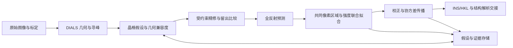

# Ariadne

**面向单晶衍射数据还原、多晶格分析与反射强度联合估计的 Agent 原生计算框架。**

[English](README.md) · [简体中文](README.zh-CN.md) · [日本語](README.ja.md) · [MIT 开源许可](LICENSE)

Ariadne 将旋转衍射图像接入保留科学证据的晶体学工作流，覆盖仪器几何、寻峰、晶格假设、联合精修、全反射预测、重叠积分、校正及结构解析交接。应用对象包括小分子、配位化合物和材料晶体，重点关注大晶胞、多取向畴及多个独立晶体共同受照的情形。

数值基础为 DIALS、dxtbx、cctbx、NumPy 和 SciPy。Ariadne 提供明确的 DIALS Python 源码扩展及独立科学适配器。确定性工具负责几何与像素估计；Agent 负责选择策略、分配计算资源、审查证据和保留备选假设。

## 1. 科学范围与架构

主要输入为单波长 X 射线旋转图像，以及可解释的探测器、光束、测角仪和扫描元数据。Bruker、Rigaku 数据能否处理，取决于相应 dxtbx 读取器能否恢复真实实验几何。文件扩展名不能单独证明格式兼容性或标定质量。

实验观测与理论反射是不同的数据对象：一个像素区域可包含多个反射贡献，一个反射也可跨越多帧。Ariadne 保留这些关系，不强制每个观测斑点只有一个晶格标签。



同相取向畴、晶体学孪晶、独立晶体与不同晶相具有不同的物理含义。相容晶胞或多套取向矩阵本身不足以确定孪晶律，也不足以支持共享结构因子强度。

## 2. DIALS 源码集成

源码补丁位于 [`patches/dials-3.30.1-ariadne.patch`](patches/dials-3.30.1-ariadne.patch)，兼容目标为 DIALS **3.30.1**。安装器取得对应上游源码并应用补丁，通过显式 `PYTHONPATH` 覆盖层复用匹配的已安装编译扩展。

| DIALS 接入位置 | Ariadne 中的作用 |
|---|---|
| `algorithms/indexing/lattice_search/__init__.py` | 注册 `ariadne` 候选评分器、PHIL 参数及结构化候选证据输出。 |
| `algorithms/indexing/model_evaluation.py` | 按扫描块划分精修数据，固定共同仪器几何，对精修晶体进行留出评价，并将证据附加到候选结果。 |
| `extensions/ariadne_spotfinder_threshold_ext.py` | 实现 DIALS threshold 接口，将带标定的多尺度像素提议交给 `ariadne.spots`。 |

指标化评估与晶格选择路径属于 Python 源码修改；寻峰模块属于注册扩展。局部轮廓学习、非互斥匹配和像素联合积分是独立适配器，不是 DIALS C++ 内核的替换。上游默认算法仍可使用，Ariadne 的 threshold 和 scorer 均需显式选择。

### 2.1 带标定的多尺度寻峰

对 ADU 像素值 $Y_j$、已标定偏置 $b_0$ 和增益 $g$（ADU/光子），用于检测的坐标为

$$
X_j=\frac{Y_j-b_0}{g},\qquad v_r=\frac{\sigma_r^2}{g^2}.
$$

掩膜参与全部局部求和。环形邻域排除候选信号支持，从有效像素估计背景，并迭代去除对**背景估计**造成正向污染的像素；实测图像值始终保留。有效背景支持不足时不产生提议。

实现对多个尺寸的方形核进行评价。设核内观测和为 $n$、预期背景和为 $\mu$，Poisson 分支采用单侧 deviance 评分：

$$
T(n,\mu)=
\begin{cases}
\sqrt{2\left[n\log(n/\mu)-n+\mu\right]},& n>\mu,\\
0,& n\leq\mu.
\end{cases}
$$

预期计数下限 0.5 用于处理采样背景为空时的数值正则化，不代表实测计数或方差。积分型探测器分支采用包含增益、读出噪声及背景估计不确定性的准高斯超额评分，不是精确的 Poisson–Gaussian 卷积似然。

当某一尺度超过评分阈值，且该像素满足局部支持条件时，才将其提议为候选信号。随后由 DIALS 构建连通斑点并执行晶体学指标化。因此，评分标识的是候选信号，不是已经独立确认的 Bragg 反射。自适应背景估计与多尺度选择使其不能直接解释为已校准的假阳性概率。

方形核通过可分离滑动滤波计算；对于 $N$ 个像素和 $S$ 个尺度，计算量近似为 $O(SN)$，避免逐像素遍历整个邻域。这是计算结构说明，不是实测提速结论。

实现：[`python/src/ariadne/spots.py`](python/src/ariadne/spots.py)。

### 2.2 按扫描块留出的精修评价

候选评估器依据原始 `imageset_id` 及下式对观测分组：

$$
\operatorname{block}(i)=\left\lfloor\frac{z_i}{L}\right\rfloor,
$$

其中 $z_i$ 为帧坐标，$L$ 为块宽。通过固定随机种子选择完整扫描块，将其排除在短程晶体精修之外。随候选变化的已分配反射 ID 不用于定义分区。

候选精修固定光束、探测器和测角仪，使各晶格在共同仪器坐标系中比较倒易坐标。评分使用精修后的晶体，而非只评价其初始矩阵。

这是**有条件的精修留出**：候选生成、初始 HKL 分配和非原胞处理可能已经使用这些观测，不能据此声称独立的端到端交叉验证。扫描块划分本身也不证明相邻块统计独立。

### 2.3 周期晶格密度评分

采用不含 $2\pi$ 因子的晶体学倒易空间约定。对候选矩阵 $A=UB$，

$$
\mathbf q=\mathbf s_1-\mathbf s_0,\qquad
|\mathbf s_0|=|\mathbf s_1|=1/\lambda,\qquad
\mathbf f=A^{-1}\mathbf q.
$$

只比较到最近晶格节点的欧氏残差，可能偏向过密倒易点阵。Ariadne 使用无量纲的周期高斯密度比：

$$
R_A(\mathbf q)=|\det A|\sum_{\mathbf h\in\mathbb Z^3}
\frac{\exp\left[-\|\mathbf q-A\mathbf h\|^2/(2\sigma_q^2)\right]}
{(2\pi\sigma_q^2)^{3/2}}.
$$

$|\det A|$ 是由 $A$ 张成的倒易晶胞体积。乘以该体积，相当于将周期密度表示为相对于候选基本胞内均匀密度的比值，从而减弱单纯通过加密倒易节点来解释观测的倾向；它不能替代完整的超胞或晶相判定。

排序统计量为

$$
\mathcal S(A)=\frac{1}{N_{\mathrm{val}}}
\sum_{i\in\mathrm{val}}
\log\left[(1-\eta)+\eta R_A(\mathbf q_i)\right].
$$

高斯尺度 $\sigma_q$ 与混合权重 $\eta$ 是明确配置的假设，尤其 $\eta$ 不是孪晶体积分数。该评分用于候选排序，不是晶格数或空间群的已校准贝叶斯证据。当前密度模型采用整数晶格位置与各向同性噪声，不包含系统消光或反射强度似然。

候选还需满足留出支持数与中心化 HKL 的三维秩条件。训练支持不足、分区无效或周期求和预算不足的候选，不获得可接受评分。

### 2.4 自适应周期邻域与内存控制

无限求和在 $\operatorname{round}(A^{-1}\mathbf q)$ 附近近似计算。分数坐标噪声尺度与搜索半径为

$$
\sigma_{f,j}=\sigma_q\|\operatorname{row}_j(A^{-1})\|_2,
\qquad
r_j=\max\left(1,\left\lceil\tfrac12+t\sigma_{f,j}\right\rceil\right).
$$

搜索半径随晶胞度量和噪声假设变化，不为所有晶胞固定使用 27 个邻近节点。半径预算限制搜索范围，批量计算依据工作内存估计选择 chunk size，`logsumexp` 避免高斯累加下溢。有限邻域属于数值近似，不是经过认证的截断误差上界。

| 参数 | 含义 | 默认值 |
|---|---|---|
| `holdout_block_frames` | 留出块的宽度 | 20 帧 |
| `holdout_fraction` | 近似留出的扫描块比例 | 0.2 |
| `q_sigma` | 假设的倒易坐标噪声尺度 | 0.001 Å⁻¹ |
| `tail_sigma` | 以分数噪声尺度表示的邻域范围 | 6 |
| `max_periodic_radius` | 每轴最大整数搜索半径 | 6 |
| `score_chunk` | 请求的观测批量大小 | 512 |
| `lattice_fraction` | 工作混合权重 $\eta$ | 0.6 |

这些值是可配置的算法设置，不是对所有实验普遍有效的标定常数。候选记录保留晶胞、$A$、支持数、残差、邻域大小与评分假设。

实现：[`python/src/ariadne/ranking.py`](python/src/ariadne/ranking.py)。

## 3. 多晶格兼容度与联合几何精修

完整的 DIALS 反射预测提供满足 Ewald 球和仪器几何的探测器位置与扫描角。倒易空间筛选后，使用一致的 mm/mm/radian 单位比较预测与观测：

$$
\mathbf r_{ikh}=\mathbf y_i-\boldsymbol\mu_{kh},\qquad
C_{ikh}=\Sigma_i+\Sigma_{kh}^{\mathrm{model}},\qquad
D_{ikh}^2=\mathbf r_{ikh}^{\mathsf T}C_{ikh}^{-1}\mathbf r_{ikh}.
$$

兼容度定义为 $r_{ikh}=\exp(-D_{ikh}^2/2)$。一个观测斑点可以保留多个相容预测，不强制其评分和为 1。适配器需要提供模型协方差与实测质心方差；观察协方差当前采用对角近似。原生、未折叠的扫描角避免仅因角度周期性而合并不同转圈的曝光。

几何兼容度、像素强度贡献及晶畴比例是不同的量。位置相容不决定实测强度如何分配到该晶格。

联合精修适配器采用**唯一解释的锚点**、软权重及 DIALS 原生 refiner，并固定仪器几何。含多个潜在贡献的质心保留用于像素分析，不复制为多次独立几何测量。不同精修假设在相同留出行与标定条件下比较；覆盖率和兼容度增益仍需物理解释。

实现：[`soft_multi_indexer.py`](skills/ariadne-reduction/scripts/soft_multi_indexer.py)、[`joint_geometry_refine.py`](skills/ariadne-reduction/scripts/joint_geometry_refine.py) 和 [`compare_hypotheses.py`](skills/ariadne-reduction/scripts/compare_hypotheses.py)。

## 4. 局部经验轮廓

独立参考 shoebox 提供扣除背景后的非负经验轮廓。轮廓按质心对齐，并在共同有限支持上归一化。在有限的探测器位置/扫描网格内，局部轮廓向 pooled 参考收缩：

$$
P_c=\alpha_c\overline P_c+(1-\alpha_c)P_{\mathrm{pool}},
\qquad \alpha_c=\frac{n_c}{n_c+\kappa}.
$$

$n_c$ 为局部参考数，$\kappa$ 为配置的收缩强度。非负三线性插值保持轮廓归一化；节点缺参考或预测位置超出参考覆盖时采用 pooled 轮廓。该方法允许有限局部变化，不为每个弱反射独立拟合任意峰形。

轮廓标定、完整支持、独立性证据和参考选择来源必须明确。轮廓属于有条件的经验探测器空间模型，其估计误差不包含在所报告的强度协方差中。

实现：[`learn_profile_library.py`](skills/ariadne-reduction/scripts/learn_profile_library.py) 和 [`local_profiles.py`](skills/ariadne-reduction/scripts/local_profiles.py)。

## 5. 重叠联合积分与可辨识性

### 5.1 共同像素观测

所有候选晶格预测反射，包括初始斑点表中未检出的弱反射。信号支持与背景 halo 在同一原始扫描、同一探测器 panel 上构建保守连通区域；每个区域对其贡献者集合只提取一次。

积分框相交用于分组。信号轮廓的重叠程度与统计可分离性，则通过设计矩阵和轮廓相关性单独评价。

### 5.2 有符号加权最小二乘

组内观测模型为

$$
\mathbf y=P\mathbf I+B\boldsymbol\beta+\boldsymbol\epsilon,
\qquad W=\operatorname{diag}(v_j^{-1}).
$$

$P$ 的每列为在完整支持上归一化的轮廓，$B$ 表示常数或低阶空间/扫描背景。有符号 WLS 保留弱反射噪声产生的负强度估计。

令 $W^{1/2}B=QR$，通过下式消去背景的 nuisance 方向：

$$
D=(I-QQ^{\mathsf T})W^{1/2}P,\qquad
\widetilde{\mathbf y}=(I-QQ^{\mathsf T})W^{1/2}\mathbf y.
$$

实现通过矩阵乘法应用投影，不构造像素数平方大小的稠密投影矩阵。随后进行列归一化与 SVD，确定保留的信号子空间和相应条件协方差。

设 $S$ 为列尺度矩阵，$V_0$ 为 $DS^{-1}$ 的零空间基。当

$$
V_0^{\mathsf T}S^{-1}\mathbf c=0
$$

时，强度对比 $\mathbf c^{\mathsf T}\mathbf I$ 可估计。

因此，单分量强度、总强度和未解决组是不同输出状态。若 $P_1=P_2$，像素决定 $I_1+I_2$，但不能决定两个分量。任意伪逆解或非负拆分不会作为实测分量强度发布。

### 5.3 非负估计器

NNLS 分支从显著轮廓支持之外估计低阶背景并冻结，然后求解

$$
\min_{\mathbf I\geq0}
\left\|W^{1/2}(\mathbf y-\mathbf b-P\mathbf I)\right\|_2^2.
$$

对于已确认的光子计数，Poisson 分支最小化

$$
\mathcal L(\mathbf I)=\sum_j
\left[\lambda_j-N_j\log\lambda_j\right],
\qquad \lambda_j=b_j+\sum_a I_aP_{ja},\quad I_a\geq0.
$$

该分支需要已标定增益、已去除偏置、零读出方差，以及有效像素上的非负整数光子计数。结果和协方差换回 calibrated-ADU 约定，以与后续校正相容。存在读出噪声时可显式选择 `poisson-gaussian`，使用完整有界卷积并支持负 ADU；超出求和预算明确失败。

有符号 WLS 的条件协方差包含 nuisance background 的不确定性，条件为给定轮廓、几何与噪声模型。冻结背景的非负分支不传播背景估计误差，其高斯/Fisher 近似也不是边界置信区间；位于非负边界的可辨识强度带质量标记。现在为可辨识分量与总量提供条件 profile-likelihood 区间，使用 chi-square(1) 渐近阈值；不宣称低计数边界的精确覆盖率。

实现：[`overlap_prepare.py`](skills/ariadne-reduction/scripts/overlap_prepare.py)、[`overlap_integrator.py`](skills/ariadne-reduction/scripts/overlap_integrator.py) 和 [`constrained_pixels.py`](skills/ariadne-reduction/scripts/constrained_pixels.py)。

位置 nuisance、Poisson–Gaussian、非负区间及单源多晶格 EM 的启用方式与限制见 [新增算法说明](skills/ariadne-reduction/references/algorithm-upgrades.md)。

## 6. 强度定义、校正与导出

拟合振幅对应完整归一化轮廓。若有效观察支持的质量为 $p_a$，相应观测振幅为 $p_aI_a$。这里的质量来自轮廓模型，不是独立测得的几何 partiality；后续校正不得再次将完整轮廓振幅除以该质量。

对分量校正 $\mathbf z=\mathbf f\odot\mathbf I$，令 $F=\operatorname{diag}(\mathbf f)$、$J=\operatorname{diag}(\mathbf I)$。一阶误差传播为

$$
C_z=FC_IF+JC_fJ+FC_{If}J+JC_{If}^{\mathsf T}F.
$$

组总强度的方差为 $\mathbf1^{\mathsf T}C_z\mathbf1$。存在校正因子不确定性或强度–因子交叉协方差时，须提供对应信息。若只能辨识原始总强度，校正适配器要求共同校正因子；各分量因子不同时，`global_scale.py` 仍把这些组放进跨等效反射的联合估计，但不拆出分量强度导出。

校正适配器应用有来源的 Lorentz/偏振、尺度与吸收因子。`global_scale.py` 在各晶畴共享一组扫描尺度与二阶方向吸收参数，等效反射在畴内共享强度、畴间不强制相等，因而不通过等均值化消除真实相对贡献。该吸收是经验相对传输，不估计绝对 $\mu$ 或晶体外形，见 [全局缩放规范](skills/ariadne-reduction/references/global-scaling.md)。

内部 JSON/JSONL 保留贡献者映射、协方差、来源和假设关系。HKLF 5 是真实、已校正、同相组合观测的下游视图，并附观察组到导出行的映射；它无法编码全部分量或跨观测协方差。HKLF 4 解析输入与 HKLF 5 孪晶精修输入保持独立，不将无关晶相导出为一个孪晶结构。

## 7. Agent 接口

本地 MCP server 提供有时间预算的类型化操作、不可覆盖的假设记录和追加式事件日志。科学接受与进程成功退出是独立决策。

每个工具都发布 `outputSchema`，客户端可据此校验返回结构而无需读源码；未在模型中逐一列出的字段仍然保留。`capabilities().analyses` 以机器可读形式给出每个分析阶段的脚本、按序输入角色、可选输入、期望输出和适用选项，`start_analysis` 直接执行同一份声明，因此文档与行为不会分叉。

| 工具 | 职责 |
|---|---|
| `capabilities` | 读取软件配置、原生操作与结构化分析契约。 |
| `create_job` | 创建独立工作数据集，保留原始输入。 |
| `start_operation` | 异步提交固定的 DIALS 原生操作。 |
| `start_analysis` | 按 `capabilities().analyses` 声明校验输入后提交科学适配器。 |
| `inspect_job` | 读取阶段、假设和计算状态。 |
| `read_artifact` | 读取有长度限制的文本证据和日志。 |
| `propose_hypothesis` | 保存候选、证据引用及 parent 关系。 |
| `record_acceptance` | 记录有证据支持的科学判断。 |
| `make_handoff` | 为 `solve-single-crystal` 打包已接受的 INS/HKL。 |

科学适配器涵盖软匹配、联合几何精修、轮廓学习、重叠构建、强度联合拟合、假设比较和 HKLF 5 导出。命令通过参数列表调用，不提供任意 shell 执行入口。Agent 不直接修改用于强度估计的数值数组。

## 8. 安装与运行

安装器面向 macOS/POSIX 环境，需要 Git、`curl`、`patch` 和相容的 conda/mamba 安装。源码补丁要求 DIALS 3.30.1，科学环境使用 Python 3.12；提供的安装器不覆盖原生 Windows 部署。

```bash
git clone https://github.com/owenxyzhang-seseTJ/Ariadne.git
cd Ariadne
sh scripts/install_local.sh
codex plugin marketplace add "$PWD" --json
codex plugin add ariadne@ariadne-local --json
```

安装器可接收 base-environment prefix 和全新的 runtime 目录作为可选参数。`ARIADNE_MAMBA` 指定 mamba 程序，`ARIADNE_SOURCE_ARCHIVE` 指定匹配的本地上游归档。生成的 `ariadne-env` 启动器选择源码覆盖层和本地 MCP 依赖。安装本身不执行科学计算。

在包含实际输入产物的独立计算目录中，显式选择源码扩展：

```bash
# CALIBRATED_GAIN 必须来自探测器标定。
ariadne-env dials.find_spots imported.expt \
  spotfinder.threshold.algorithm=ariadne \
  spotfinder.threshold.ariadne.noise_model=poisson \
  spotfinder.threshold.ariadne.gain_adu_per_photon="$CALIBRATED_GAIN"

ariadne-env dials.index imported.expt strong.refl \
  indexing.basis_vector_combinations.solution_scorer=ariadne \
  indexing.basis_vector_combinations.ariadne.evidence_directory=candidate_evidence
```

通过 Agent 执行还原时调用 `$ariadne-reduction`。[技能入口](skills/ariadne-reduction/SKILL.md) 定义数据层级路由和证据要求。详细适配器契约见 [多晶格方法说明](skills/ariadne-reduction/references/probabilistic-multilattice.md)、[源码扩展规范](skills/ariadne-reduction/references/source-extensions.md) 和 [重叠积分规范](skills/ariadne-reduction/references/overlap-integration.md)、[全局缩放规范](skills/ariadne-reduction/references/global-scaling.md)。

## 9. 科学适用性

提供的算法属于尚无公开基准验证的实验性实现。数值阈值与不确定性假设需结合具体数据评价；本仓库不提出量化准确率或吞吐量结论。

当前几何适配器采用静态旋转模型。完整多源质心似然优化、正式的贝叶斯晶格数选择及轮廓/几何估计误差传播，均不属于已实现数值模型。全局缩放吸收要求几何、LP 与方向有可追溯来源，且只覆盖可辨识的共享低阶项。动态结构解释需要独立标定和可辨识的仪器–样品模型。

## 10. 开源许可与参考资料

Ariadne 独立编写的软件和文档采用 [MIT License](LICENSE) 开源。DIALS 派生源码保留其上游 BSD 条款，见 [`patches/DIALS-LICENSE`](patches/DIALS-LICENSE)。第三方依赖保留各自许可。本仓库不分发官方 DAFi 二进制或专有采集/还原程序。

- Winter 等：**DIALS: implementation and evaluation of a new integration package.** *Acta Crystallographica D* 74, 85–97。[DOI: 10.1107/S2059798317017235](https://doi.org/10.1107/S2059798317017235)。
- Sevvana 等：**Non-merohedral twinning: from minerals to proteins.** *Acta Crystallographica D*。[DOI: 10.1107/S2059798319010179](https://doi.org/10.1107/S2059798319010179)。
- [DIALS 扩展接口](https://dials.github.io/documentation/library_reference/extensions/index.html) 与 [上游源码](https://github.com/dials/dials/tree/v3.30.1)。
- [SciPy 有界线性最小二乘](https://docs.scipy.org/doc/scipy/reference/generated/scipy.optimize.lsq_linear.html) 与 [受约束最小化](https://docs.scipy.org/doc/scipy/reference/generated/scipy.optimize.minimize.html)。
