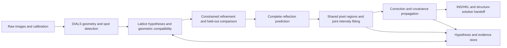

# Ariadne

**An agent-native framework for single-crystal diffraction reduction, multi-lattice analysis, and joint reflection-intensity estimation.**

[English](README.md) · [简体中文](README.zh-CN.md) · [日本語](README.ja.md) · [Commercial License](LICENSE)

Ariadne connects rotation diffraction images to an evidence-preserving crystallographic workflow: instrument geometry, spot detection, lattice hypotheses, joint refinement, complete reflection prediction, overlap integration, correction, and structure-solution handoff. It targets small-molecule, coordination, and materials crystallography, including large unit cells and specimens containing multiple orientation domains or independent crystals.

The numerical foundation is DIALS, dxtbx, cctbx, NumPy, and SciPy. Ariadne supplies explicit DIALS Python-source extensions and separate scientific adapters. Deterministic tools evaluate geometry and pixel data; the agent selects strategies, manages resources, reviews evidence, and preserves alternative hypotheses.

### Complex-twin and weak-signal mathematical update

**Round 2** adds analytic rotation-prediction derivatives, Gaussian face-flux
position derivatives, bounded-workspace square-root WLS, stable conditional
likelihood ratios, an optional profiled scaling solver, and streaming HKLF5
export. See [the round-2 guide](ROUND2_OPTIMIZATION.md) and
[its mathematical derivation](reports/ariadne_round2.tex). The first-round
derivation and measurements below remain part of the delivery.

The 2026-10-29 revision retains locally observable intensity combinations for
global inference, adds an observability-based acquisition-design diagnostic,
stabilizes lattice scoring under integer basis changes, and accelerates the exact
Poisson–Gaussian kernel while using its own likelihood curvature. Existing
scientific command paths remain available. See
[the update and reproduction guide](FIRST_PRINCIPLES_UPDATE.md) and
[the complete mathematical derivation](reports/ariadne_first_principles.tex).
The guide records the native regression results, synthetic benchmarks, and the
distinction between numerical validation and experimental diffraction accuracy.

## 1. Scientific scope and architecture

The primary input is single-wavelength X-ray rotation imagery with interpretable detector, beam, goniometer, and scan metadata. Bruker and Rigaku datasets are supported where the relevant dxtbx reader can recover the actual experimental geometry. A filename extension alone does not establish format compatibility or calibration quality.

A crystallographic observation and a theoretical reflection are separate objects. One pixel region may contain several reflection contributions, while a reflection may span several frames. Ariadne retains these relationships rather than imposing one lattice label on every observed spot.



Single-phase orientation domains, crystallographic twins, independent crystals, and distinct phases require different physical interpretations. Compatible unit cells or multiple orientation matrices alone do not establish a twin law or justify sharing structure-factor intensities.

## 2. DIALS source integration

The source patch is provided in [`patches/dials-3.30.1-ariadne.patch`](patches/dials-3.30.1-ariadne.patch). Its compatibility target is DIALS **3.30.1**. The installer retrieves the corresponding upstream source and applies the patch; an explicit `PYTHONPATH` overlay uses the matching installed compiled extensions.

| DIALS integration point | Function in Ariadne |
|---|---|
| `algorithms/indexing/lattice_search/__init__.py` | Registers the `ariadne` candidate scorer, its PHIL parameters, and structured candidate-evidence output. |
| `algorithms/indexing/model_evaluation.py` | Partitions refinement data by scan block, fixes the common instrument geometry, evaluates the refined crystal on held-out observations, and attaches evidence to the candidate result. |
| `extensions/ariadne_spotfinder_threshold_ext.py` | Implements the DIALS threshold interface; defaults to self-calibrated matched-filter proposals and retains the multiscale detector. |

The indexing evaluator and lattice-selection path are Python-source modifications. The threshold module is a registered extension. Local profile learning, nonexclusive matching, and joint pixel integration are separate adapters, not replacements for the DIALS C++ kernels. The agent now selects the Ariadne matched threshold by default; upstream algorithms and the Ariadne indexing scorer remain explicit choices.

### 2.1 Self-calibrated matched-filter proposals

The current Ariadne threshold defaults to `algorithm=matched`. It estimates a radial profile times a spatial background, calibrates effective gain/pedestal/readout variance, and propagates twelve sampled pixel correlations into two binomial matched filters. Local background corrections remain nonnegative. Gaussian-field peak thresholds are design targets requiring detector-specific validation. Background, calibration and scores use double precision; macOS can use up to four work units without reducing samples or iterations. The [current report](../reports/current_validation/MATCHED_OPTIMIZATION.zh-CN.md) contains equations, held-out comparisons, real-frame reference limitations, timing and reproduction commands. Detection is still slower than DIALS in the recorded comparison.

DIALS supplies corrected pixels to the threshold callback. A temporary inverse of its gain/pedestal correction restores raw ADU for the Ariadne noise model; downstream centroid and integration pixels retain DIALS units. Production adapters use `dials_runtime.py` for consistent signed absolute Bruker100 underflows during import, detection and integration. Explicit expert commands must use that same runner for each image-reading stage.

### 2.2 Retained multiscale proposals

The earlier count-excess detector remains available as `algorithm=multiscale`; its earlier benchmark is retained below.

For an ADU pixel value $Y_j$, a calibrated offset $b_0$, and gain $g$ in ADU per photon, the detection coordinate is

$$
X_j=\frac{Y_j-b_0}{g},\qquad v_r=\frac{\sigma_r^2}{g^2}.
$$

The mask enters every local sum. An annular neighborhood excludes the candidate support and estimates the background from valid pixels. Optional clipping can iteratively remove positive contaminants from the **background estimate**; measured image values are always retained. Insufficient valid background support prevents a proposal.

The implementation evaluates box kernels of several sizes. The default statistic standardizes the excess by expected count, readout variance, and background-estimation variance:

$$
Z=\frac{\max(n-\mu,0)}
{\sqrt{\max(\mu+n_vv_r+W^2\sum v_b,.5)}},
$$

where $W$ is the square-kernel width, $n_v$ is the valid-pixel count, and $v_b$ is the propagated annular background variance. The $W^2$ multiplier preserves the dominant correlation of a locally shared background estimate and is a conservative effective-variance model, not an exact posterior covariance. This gives all kernel sizes the same decision scale. Connected components smaller than four pixels are removed by default.

The earlier count-excess mode remains available for exact reproduction. For observed kernel sum $n$ and expected background sum $\mu$, its Poisson branch uses the one-sided deviance score

$$
T(n,\mu)=
\begin{cases}
\sqrt{2\left[n\log(n/\mu)-n+\mu\right]},& n>\mu,\\
0,& n\leq\mu.
\end{cases}
$$

The expected-count floor of 0.5 is numerical regularization for an empty sampled background. It is not a measured count or variance. The integrating-detector branch instead uses a quasi-Gaussian excess score with gain, readout noise, and estimated background uncertainty; it is not an exact Poisson–Gaussian convolution likelihood.

A pixel is proposed when a scale exceeds the score threshold and the pixel satisfies the local support condition. DIALS subsequently constructs connected spots and carries out crystallographic indexing. The score therefore identifies candidate signal, not an independently verified Bragg reflection. Adaptive background estimation and scale selection mean that it is not a calibrated false-positive probability.

The C++ kernel uses summed-area statistics, can run without the Python GIL, and evaluates score maps only at candidate pixels. On a fixed synthetic train/validation/final-test split, the standardized default raised final-test F1 from 0.793 to 0.852 and weak-spot recall from 3.4% to 18.2%; the report retains false positives and localization error. This benchmark is threshold plus component extraction, not the complete DIALS indexing pipeline.

Implementation: [`python/src/ariadne/spots.py`](python/src/ariadne/spots.py).

### 2.3 Scan-block refinement holdout

The candidate evaluator groups observations by the original `imageset_id` and

$$
\operatorname{block}(i)=\left\lfloor\frac{z_i}{L}\right\rfloor,
$$

where $z_i$ is the frame coordinate and $L$ the block width. A seeded selection of whole blocks is excluded from short crystal refinement. Candidate-dependent assigned reflection IDs do not define the partition.

The beam, detector, and goniometer are fixed during candidate refinement so that reciprocal coordinates are compared in a common instrument frame. The refined crystal, rather than only its initial matrix, supplies the subsequent lattice score.

This is a **conditional refinement holdout**: candidate generation, initial HKL assignment, and non-primitive-cell handling may already have used the observations. It does not constitute independent end-to-end cross-validation. Scan-block partitioning also does not prove that adjacent blocks are statistically independent.

### 2.4 Periodic lattice-density scoring

Use the crystallographic reciprocal-space convention without a $2\pi$ factor. For a candidate $A=UB$,

$$
\mathbf q=\mathbf s_1-\mathbf s_0,\qquad
|\mathbf s_0|=|\mathbf s_1|=1/\lambda,\qquad
\mathbf f=A^{-1}\mathbf q.
$$

A Euclidean residual to the nearest lattice node alone can favor an excessively dense reciprocal lattice. Ariadne evaluates a dimensionless periodic Gaussian density ratio:

$$
R_A(\mathbf q)=|\det A|\sum_{\mathbf h\in\mathbb Z^3}
\frac{\exp\left[-\|\mathbf q-A\mathbf h\|^2/(2\sigma_q^2)\right]}
{(2\pi\sigma_q^2)^{3/2}}.
$$

Here $|\det A|$ is the volume of the reciprocal cell spanned by $A$. Multiplication by this volume expresses the periodic density relative to a uniform density on the candidate fundamental cell. It reduces the incentive to explain points merely by making the reciprocal lattice denser; it is not a complete supercell or phase-identification test.

The ranking statistic is

$$
\mathcal S(A)=\frac{1}{N_{\mathrm{val}}}
\sum_{i\in\mathrm{val}}
\log\left[(1-\eta)+\eta R_A(\mathbf q_i)\right].
$$

The Gaussian scale $\sigma_q$ and mixture weight $\eta$ are explicit configured assumptions. In particular, $\eta$ is not a twin-domain volume fraction. The score is a candidate-ranking diagnostic, not calibrated Bayesian evidence for the number of lattices or for a space group. The density model uses integer lattice positions and isotropic noise; systematic absences and reflection-intensity likelihoods are not included.

Candidates must also satisfy held-out support and three-dimensional centered HKL-rank criteria. Insufficient training support, invalid partitions, or insufficient periodic-sum budgets do not receive an accepted candidate score.

### 2.5 Adaptive periodic neighborhoods and memory control

The infinite sum is approximated around $\operatorname{round}(A^{-1}\mathbf q)$. The fractional-coordinate noise scale and search radius are

$$
\sigma_{f,j}=\sigma_q\|\operatorname{row}_j(A^{-1})\|_2,
\qquad
r_j=\max\left(1,\left\lceil\tfrac12+t\sigma_{f,j}\right\rceil\right).
$$

The radius grows with the unit-cell metric and assumed noise width, rather than imposing the same 27 neighboring nodes on every cell. A configured radius budget bounds the search. Batched evaluation uses a working-memory estimate to choose a chunk size, and `logsumexp` avoids underflow in the Gaussian accumulation. The finite neighborhood is a numerical approximation, not a certified truncation-error bound.

| Parameter | Meaning | Default |
|---|---|---|
| `holdout_block_frames` | Width of a validation block | 20 frames |
| `holdout_fraction` | Approximate fraction of blocks withheld | 0.2 |
| `q_sigma` | Assumed reciprocal-coordinate noise scale | 0.001 Å⁻¹ |
| `tail_sigma` | Neighborhood extent in fractional noise units | 6 |
| `max_periodic_radius` | Maximum integer radius on each axis | 6 |
| `score_chunk` | Requested observation batch size | 512 |
| `lattice_fraction` | Working mixture weight $\eta$ | 0.6 |

These are configurable algorithm settings, not universally calibrated experimental constants. Candidate traces retain the cell, $A$, support, residuals, neighborhood size, and assumptions.

Implementation: [`python/src/ariadne/ranking.py`](python/src/ariadne/ranking.py).

## 3. Multi-lattice compatibility and joint geometry refinement

Complete DIALS predictions provide detector positions and scan angles under the Ewald-sphere and instrument geometry. Reciprocal-space screening is followed by positional comparison in consistent mm/mm/radian units:

$$
\mathbf r_{ikh}=\mathbf y_i-\boldsymbol\mu_{kh},\qquad
C_{ikh}=\Sigma_i+\Sigma_{kh}^{\mathrm{model}},\qquad
D_{ikh}^2=\mathbf r_{ikh}^{\mathsf T}C_{ikh}^{-1}\mathbf r_{ikh}.
$$

The compatibility score is $r_{ikh}=\exp(-D_{ikh}^2/2)$. Several predictions may remain compatible with one observed spot; these scores are not forced to sum to one. A supplied model covariance and measured centroid variances are required. The observation covariance currently uses a diagonal approximation. Native unwrapped scan angles prevent observations from different revolutions being combined solely by angular periodicity.

Geometric compatibility, pixel-intensity contribution, and domain fraction are three distinct quantities. A compatible position does not determine how much measured intensity belongs to that lattice.

The joint-refinement adapter uses **uniquely explained anchors**, soft weights, and the native DIALS refiner. The instrument geometry remains fixed. A centroid with several possible contributors is retained for pixel-level analysis, rather than duplicated as several independent geometric measurements. Alternative refined hypotheses are compared on the same held-out rows and calibration assumptions; coverage and compatibility gains remain diagnostics requiring physical interpretation.

Implementations: [`soft_multi_indexer.py`](skills/ariadne-reduction/scripts/soft_multi_indexer.py), [`joint_geometry_refine.py`](skills/ariadne-reduction/scripts/joint_geometry_refine.py), and [`compare_hypotheses.py`](skills/ariadne-reduction/scripts/compare_hypotheses.py).

## 4. Local empirical profiles

Isolated reference shoeboxes supply background-subtracted, nonnegative empirical profiles. Profiles are centroid-aligned and normalized on a common finite support. Within a bounded detector-position/scan grid, the local profile is shrunk toward the pooled reference:

$$
P_c=\alpha_c\overline P_c+(1-\alpha_c)P_{\mathrm{pool}},
\qquad \alpha_c=\frac{n_c}{n_c+\kappa}.
$$

Here $n_c$ is the local reference count and $\kappa$ the configured shrinkage strength. Nonnegative trilinear interpolation preserves profile normalization. Missing nodes or positions outside reference coverage use the pooled profile. This permits bounded local variation without independently fitting an arbitrary shape to every weak reflection.

Profile calibration, complete support, isolation evidence, and reference-selection provenance are required. Profiles are conditional empirical detector-space models; their estimation uncertainty is not included in the reported intensity covariance.

Implementations: [`learn_profile_library.py`](skills/ariadne-reduction/scripts/learn_profile_library.py) and [`local_profiles.py`](skills/ariadne-reduction/scripts/local_profiles.py).

## 5. Joint overlap integration and identifiability

### 5.1 Shared pixel observations

All candidate lattices predict reflections, including weak reflections absent from the initial spot list. Supports and background halos define conservative connected regions on the same raw scan and detector panel. Each region is extracted once for its contributor set.

Bounding-box intersection is a grouping criterion. Signal-profile overlap and statistical separability are assessed separately using the design matrix and profile correlations.

### 5.2 Signed weighted least squares

The group model is

$$
\mathbf y=P\mathbf I+B\boldsymbol\beta+\boldsymbol\epsilon,
\qquad W=\operatorname{diag}(v_j^{-1}).
$$

Each column of $P$ is a full-support normalized profile. $B$ represents a constant or low-order spatial/scan background. Signed WLS preserves negative estimates arising from noisy weak reflections.

With $W^{1/2}B=QR$, background nuisance directions are removed through

$$
D=(I-QQ^{\mathsf T})W^{1/2}P,\qquad
\widetilde{\mathbf y}=(I-QQ^{\mathsf T})W^{1/2}\mathbf y.
$$

The implementation applies the projection through matrix products; it does not construct a pixel-by-pixel dense projector. Column normalization followed by SVD identifies the retained signal subspace and its conditional covariance.

For column-scale matrix $S$ and null-space basis $V_0$ of $DS^{-1}$, a contrast $\mathbf c^{\mathsf T}\mathbf I$ is estimable when

$$
V_0^{\mathsf T}S^{-1}\mathbf c=0.
$$

Individual intensities, their sum, and unresolved groups are therefore distinct outcomes. For identical profiles, $P_1=P_2$, the pixels determine $I_1+I_2$ but not the two components. An arbitrary pseudoinverse or nonnegative split is not published as a measured component intensity.

### 5.3 Nonnegative estimators

The NNLS branch freezes a low-order background estimated outside significant profile support and solves

$$
\min_{\mathbf I\geq0}
\left\|W^{1/2}(\mathbf y-\mathbf b-P\mathbf I)\right\|_2^2.
$$

For verified photon counts, the Poisson branch minimizes

$$
\mathcal L(\mathbf I)=\sum_j
\left[\lambda_j-N_j\log\lambda_j\right],
\qquad \lambda_j=b_j+\sum_a I_aP_{ja},\quad I_a\geq0.
$$

It requires calibrated gain, removed offset, zero readout variance, and nonnegative integer photon counts on valid pixels. Results and covariance are converted back to the calibrated-ADU convention for correction compatibility. An integrating detector with appreciable readout noise uses the appropriate weighted approximation, not the ideal-count Poisson branch.

For signed WLS, nuisance-background uncertainty is included conditionally on the supplied profiles, geometry, and noise model. For the frozen-background constrained branches, background-estimation uncertainty is omitted. Their Gaussian/Fisher approximation is not a boundary confidence interval; identifiable amplitudes on the nonnegative boundary receive a quality flag. Profile-likelihood or bootstrap boundary intervals are not supplied.

Implementations: [`overlap_prepare.py`](skills/ariadne-reduction/scripts/overlap_prepare.py), [`overlap_integrator.py`](skills/ariadne-reduction/scripts/overlap_integrator.py), and [`constrained_pixels.py`](skills/ariadne-reduction/scripts/constrained_pixels.py).

## 6. Intensity conventions, correction, and export

The fitted amplitude refers to the full normalized profile. If the valid observed support contains mass $p_a$, the corresponding observed amplitude is $p_aI_a$. This is model-based valid-support mass, not an independently measured geometric partiality. Subsequent correction must not divide the full-profile amplitude by this mass again.

For component correction $\mathbf z=\mathbf f\odot\mathbf I$, define $F=\operatorname{diag}(\mathbf f)$ and $J=\operatorname{diag}(\mathbf I)$. First-order propagation gives

$$
C_z=FC_IF+JC_fJ+FC_{If}J+JC_{If}^{\mathsf T}F.
$$

The group total has variance $\mathbf1^{\mathsf T}C_z\mathbf1$. Correction-factor uncertainty and intensity–factor cross-covariance must be supplied when relevant. If only the raw total is identifiable, the current correction adapter requires a common correction factor; different component factors require a global observation model.

The correction adapter applies documented Lorentz/polarization, scale, and absorption factors. It does not estimate a complete global twin-aware absorption/scaling model or equalize domains to erase their physical relative contribution.

The internal JSON/JSONL representation retains contributor mappings, covariance, provenance, and hypothesis relationships. HKLF 5 is a downstream view of genuine corrected same-phase composite observations and includes an observation-to-line export map. It cannot encode the full component or cross-observation covariance. HKLF 4 structure-solution input and HKLF 5 twin-refinement input are kept separate; unrelated phases are not exported as one twin structure.

## 7. Agent interface

The local MCP server exposes typed operations with bounded runtime, immutable hypothesis records, and an append-only event log. Scientific acceptance is a separate decision from successful process execution.

| Tool | Role |
|---|---|
| `capabilities` | Inspect configured software and supported operations. |
| `create_job` | Create an isolated working dataset while retaining original inputs. |
| `start_operation` | Submit a fixed native DIALS operation asynchronously. |
| `start_analysis` | Submit a registered Ariadne scientific adapter. |
| `inspect_job` | Read stage, hypothesis, and operation status. |
| `read_artifact` | Retrieve bounded textual evidence and logs. |
| `propose_hypothesis` | Preserve a candidate, evidence references, and parent relationships. |
| `record_acceptance` | Record an evidence-supported scientific decision. |
| `make_handoff` | Package accepted INS/HKL data for `solve-single-crystal`. |

Scientific adapters include soft assignment, joint geometry refinement, profile learning, overlap construction, joint intensity fitting, hypothesis comparison, and HKLF 5 export. Commands use argument lists rather than arbitrary shell execution. The agent does not directly alter the numerical arrays used to estimate intensities.

## 8. Installation and operation

The installer targets a macOS/POSIX environment with Git, `curl`, `patch`, and a compatible conda/mamba installation. The source patch requires DIALS 3.30.1 and the scientific environment uses Python 3.12. Native Windows deployment is outside the provided installer.

```bash
git clone https://github.com/owenxyzhang-seseTJ/Ariadne.git
cd Ariadne
sh scripts/install_local.sh
codex plugin marketplace add "$PWD" --json
codex plugin add ariadne@ariadne-local --json
```

The installer accepts a base-environment prefix and a fresh runtime directory as optional arguments. `ARIADNE_MAMBA` selects a mamba executable, and `ARIADNE_SOURCE_ARCHIVE` selects a local matching upstream archive. The generated `ariadne-env` launcher selects the source overlay and local MCP dependencies. Installation does not execute scientific calculations.

Explicit source-extension selection, in an isolated calculation directory with the actual input artifacts:

```bash
# ARIADNE_PLUGIN_ROOT points to this complete checkout.
# Use the same runner for import and integrate when reading Bruker100 frames.
ariadne-env dials.python "$ARIADNE_PLUGIN_ROOT/skills/ariadne-reduction/scripts/dials_runtime.py" \
  "$(command -v dials.find_spots)" imported.expt \
  spotfinder.threshold.algorithm=ariadne \
  spotfinder.threshold.ariadne.algorithm=matched

ariadne-env dials.index imported.expt strong.refl \
  indexing.basis_vector_combinations.solution_scorer=ariadne \
  indexing.basis_vector_combinations.ariadne.evidence_directory=candidate_evidence
```

For agent-directed reduction, invoke `$ariadne-reduction`. The [`skill entry point`](skills/ariadne-reduction/SKILL.md) defines the data-level routing and evidence requirements. Detailed adapter contracts are documented in the [multi-lattice methodology](skills/ariadne-reduction/references/probabilistic-multilattice.md), [source-extension specification](skills/ariadne-reduction/references/source-extensions.md), and [overlap-integration specification](skills/ariadne-reduction/references/overlap-integration.md).

## 9. Scientific applicability

The supplied algorithms are experimental implementations without published benchmark validation. Numerical thresholds and uncertainty assumptions require dataset-specific assessment; the repository makes no quantified accuracy or throughput claim.

The current geometric adapters assume static rotation models. Full multi-source-centroid likelihood optimization, formal Bayesian lattice-count selection, global composite-aware absorption/scaling, and propagation of profile/geometry estimation error are outside the implemented numerical model. Dynamic structural interpretation requires independent calibration and an identifiable instrument–sample model.

## 10. License and references

Ariadne's independently authored software and documentation are proprietary. Commercial use requires a written license; see [LICENSE](LICENSE) and [LICENSING.md](LICENSING.md). Releases up to commit 407d193 remain available under the [MIT License](LICENSE-MIT). DIALS-derived source portions retain their upstream BSD conditions, reproduced in [`patches/DIALS-LICENSE`](patches/DIALS-LICENSE). Third-party dependencies retain their respective licenses. Official DAFi binaries and proprietary acquisition/reduction programs are not distributed in this repository.

- Winter et al. **DIALS: implementation and evaluation of a new integration package.** *Acta Crystallographica D* 74, 85–97. [DOI: 10.1107/S2059798317017235](https://doi.org/10.1107/S2059798317017235).
- Sevvana et al. **Non-merohedral twinning: from minerals to proteins.** *Acta Crystallographica D*. [DOI: 10.1107/S2059798319010179](https://doi.org/10.1107/S2059798319010179).
- [DIALS extension interfaces](https://dials.github.io/documentation/library_reference/extensions/index.html) and [upstream source](https://github.com/dials/dials/tree/v3.30.1).
- [SciPy bounded linear least squares](https://docs.scipy.org/doc/scipy/reference/generated/scipy.optimize.lsq_linear.html) and [constrained minimization](https://docs.scipy.org/doc/scipy/reference/generated/scipy.optimize.minimize.html).
